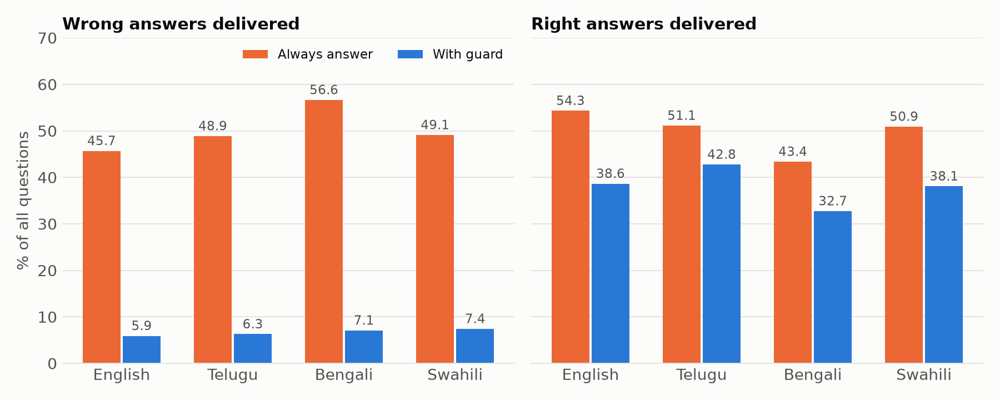
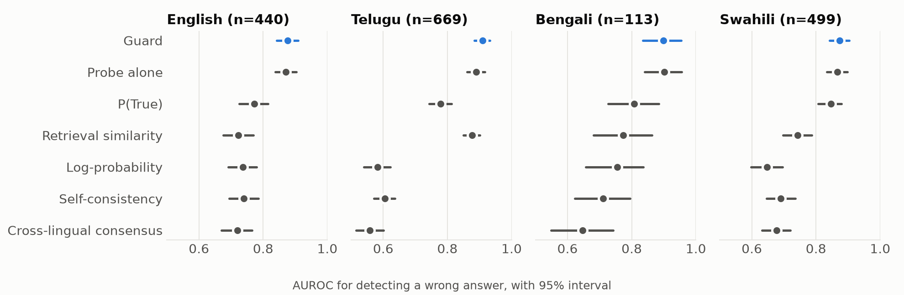
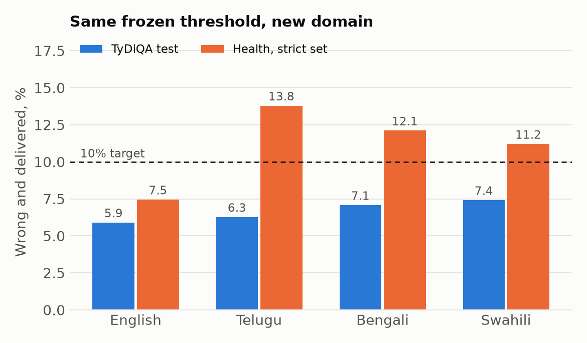

# Knows When It Doesn't Know: a hallucination guard for Tiny Aya in four languages

## 1. Problem and approach

A small multilingual model is cheap enough to run for communities that large commercial models serve poorly. It is also often wrong, and it sounds equally sure either way. Asked from memory, Tiny Aya gives a wrong answer to 94.8% of our Telugu test questions and 72.7% of English ones. In a health setting, a confident wrong answer does more harm than no answer.

We built a guard that gives the system a third option besides right and wrong: to say it does not know.

```
question -> retrieve passage -> Tiny Aya answer + activation -> risk score -> one global threshold -> answer or abstain
```

1. **Retrieve.** multilingual-e5-small finds a passage. For 30% of questions we remove the source article, so the system must face questions it cannot answer.
2. **Answer.** Tiny Aya answers from the passage. We read the layer-24 hidden state at the last answer token.
3. **Score.** A linear probe on that activation is stacked with retrieval similarity and mean log-probability.
4. **Decide.** One threshold, set on held-out data, covers all four languages.

The result on the locked test set of 1,721 questions:

| | Always answer | With guard | Change (95% interval) |
|---|---|---|---|
| Wrong answers delivered | 48.6% | **6.6%** | −42.07 pts (−44.39, −39.80) |
| Right answers delivered | 51.4% | 39.7% | −11.68 pts (−13.19, −10.17) |

The guard removes about 3.6 wrong answers for every right answer it holds back. That cost is real, and section 7 reports it alongside each result.

**Try it:** the Gradio demo code (`space/app.py`, `space/pipeline.py`) is included in the project and runs locally on one GPU with an `HF_TOKEN` from an account that has accepted the Tiny Aya licence. We did not host it, because a hosted Space needs paid hardware.

## 2. Hackathon repositories used

The three Track 2 toolkits work as one pipeline: CuratorKIT builds the domain test, CircuitKIT explains where the signal sits, and AuditKIT produces the before-and-after evidence.

| Repository | Used for | Features |
|---|---|---|
| **CuratorKIT** | Building the health test set in four languages on local models | `QAGenerationTask`, `HallucinationGate`, `DataSample`, and a `BaseLLM` adapter for local Tiny Aya (`src/curate.py`, `src/gate_check.py`, `src/strict_health.py`) |
| **CircuitKIT** | Finding where evidence use happens, and testing whether circuits pick better probe layers | `discover_circuit` with EAP-IG, `eap_to_artifact`, `LinearProbe`, `ProbeTrainer`, `HallucinationDetector` (`src/discover.py`, `src/circuit_probe.py`) |
| **AuditKIT** | Paired before-and-after reports on every run | `RunResult`, `Prediction`, `RunComparison`, `Stat`, `score_pairs` (`src/final.py`) |

We found three problems in the toolkits and describe them in section 7 so they can be fixed upstream.

## 3. Models and licences

| Model | Role | Licence |
|---|---|---|
| CohereLabs/tiny-aya-fire | Answering model, tuned for South Asian languages | CC-BY-NC-4.0 |
| CohereLabs/tiny-aya-global | Second answering model, and the judge for health data | CC-BY-NC-4.0 |
| intfloat/multilingual-e5-small | Retrieval | MIT |

We chose Tiny Aya because it is small enough to serve on one 16 GB card and covers the low-resource languages we care about. Our team reads English and Telugu, and the other two languages test whether the method travels. The CC-BY-NC licence means our demo and derived artifacts are for non-commercial use.

## 4. Datasets, benchmarks and licences

| Data | Size | Use | Licence |
|---|---|---|---|
| TyDiQA secondary task (train) | 8,800 sampled questions, 2,200 per language | Probe 70% and calibration 30%, split by article title hash | Apache-2.0 |
| TyDiQA secondary task (validation) | 1,721 questions: te 669, sw 499, en 440, bn 113 | Locked test set | Apache-2.0 |
| Wikipedia health passages | 3,910 chunks on 40 topics such as malaria, tuberculosis, cholera and snakebite | Retrieval corpus and domain test | CC BY-SA 4.0 |
| Generated health questions | 1,173: en 470, bn 369, sw 189, te 145 | Domain-shift test | CC BY-SA 4.0, with Tiny Aya output under CC-BY-NC-4.0 |

TyDiQA was written by native speakers without looking at the answer, so it is not a translation of English questions. That makes it a fair test for Telugu, Bengali and Swahili. The health topics were chosen because that is where a wrong answer is costly.

**Metrics and why we chose them.** Scoring is string matching against gold answers, with no LLM judge, so no second model can bias the result.

- *Wrong delivered* and *right delivered*, as shares of all questions, show the benefit and the cost together.
- *AUROC* and *AURC* measure how well a score ranks errors, independent of any threshold.
- *Coverage* is how often the system answers at all.
- *Latency* decides whether a guard is usable in practice.

## 5. Model artifacts

[Model collection](https://huggingface.co/collections/sricharan1234/tiny-aya-hallucination-guard-models-6af0a41dfe3d3d356a5000db), public and un-gated. It holds the 27 KB guard, which contains the scaler, probe, stacker and frozen thresholds, the loading code, and, for reference, the CircuitKIT `LinearProbe` weights from the circuit comparison, which the guard does not use. The exported guard matches the experiment code with 100% decision agreement and a maximum score difference of 1.8e-7. The base model stays gated under its own terms and is not redistributed.

## 6. Data artifacts

[Dataset collection](https://huggingface.co/collections/sricharan1234/tiny-aya-hallucination-guard-datasets-6af0a41ef264c137a04554d2), public and un-gated. It holds questions and splits, health passages and questions, model answers, baseline scores, judge scores, and final reports.

## 7. Experiments and findings

### Method settings were frozen before the test read

The layer, thresholds and risk targets were recorded with file hashes in `reports/FREEZE.txt` before any test result was read. Models were fit on the probe split and thresholds were set on the calibration split. Each test run was read once.

Two risk targets are reported, and they answer different questions:

- **Joint rule:** P(answered and wrong) at most 10%, conformal, threshold 0.447.
- **Selective rule:** wrong among answered at most 20%, Clopper-Pearson with fixed-sequence testing over a 5% coverage grid, threshold 0.363.

### Main result, per language



| Language | n | Wrong, always answer | Wrong, guard | Answered | Wrong among answered | Guard AUROC (95% interval) |
|---|---|---|---|---|---|---|
| English | 440 | 45.7% | 5.9% | 44.5% | 13.3% | .877 (.843, .909) |
| Telugu | 669 | 48.9% | 6.3% | 49.0% | 12.8% | .910 (.884, .932) |
| Bengali | 113 | 56.6% | 7.1% | 39.8% | 17.8% | .899 (.834, .954) |
| Swahili | 499 | 49.1% | 7.4% | 45.5% | 16.3% | .874 (.842, .903) |

One global threshold kept every language under the 10% target. The selective rule gives 4.4% wrong delivered, 35.6% right delivered and 39.9% answered. Retrieval alone cuts wrong answers by 34.86 points compared with closed-book answers (95% interval −37.54 to −32.36).

The method also holds on the second model. With Tiny Aya Global, with its own refitted guard, wrong delivered falls from 49.0% to 6.7% (−42.30 pts, interval −44.68 to −39.92) at 46.8% answered.

### Against other ways of detecting errors



| Method | English | Telugu | Bengali | Swahili |
|---|---|---|---|---|
| **Guard** | **.877** | **.910** | .899 | **.874** |
| Probe alone | .871 | .890 | **.902** | .866 |
| P(True) | .773 | .778 | .808 | .846 |
| Retrieval similarity | .723 | .877 | .774 | .742 |
| Log-probability | .736 | .582 | .755 | .647 |
| Self-consistency | .740 | .604 | .711 | .691 |
| Cross-lingual consensus | .719 | .558 | .647 | .677 |

The probe carries most of the signal. The guard's gain over the probe alone is statistically clear only in Telugu (+.007 to +.033). Its gain over P(True) is clear in three languages and not in Swahili (−.003 to +.061). Against the other baselines, its gain is clear in every language.

The bigger difference shows up when one threshold must serve all languages. Log-probability is a common default, but under the same global rule it delivers 26.9% wrong answers in Telugu, where the guard delivers 6.3%. Confidence does not mean the same thing across languages. The activation probe holds up much better. P(True) reaches 10.5% in English and 11.8% in Telugu, and self-consistency abstains on everything.

Per-language thresholds gave no consistent gain over one global threshold, so we keep the simpler rule.

### Cost in time

| Method | Mean seconds per question (RTX 5060 Ti, n=200) |
|---|---|
| Answer only | 0.248 |
| P(True) | 0.347 |
| **Guard** | **0.360** |
| Cross-lingual consensus | 0.761 |
| Self-consistency | 0.935 |

The guard adds 0.11 seconds. Checks that generate extra answers (cross-lingual consensus and self-consistency) add 0.5 to 0.7 seconds and detect fewer errors here. Peak GPU memory is 8.5 GB.

### Domain shift to health

The guard was never fitted on health text. We applied the frozen thresholds unchanged to the CuratorKIT health set of 1,173 questions.

Without the guard, Tiny Aya gives a wrong answer on 57.0% of these questions. With it, wrong answers delivered fall to 9.9%, and 42.6% of questions are answered. To rule out a noisy test set, we also kept only the 748 questions whose gold answer scored at least .85 with the judge, a bar chosen from the planted-answer check below and applied to gold answers and source text only. That report was run once.

| Language | Questions (full / strict) | AUROC (full / strict) | Wrong delivered, target 10% (full / strict) | Wrong among answered, target 20% (full / strict) |
|---|---|---|---|---|
| English | 470 / 322 | .902 / .910 | 6.6% / 7.5% | 12.0% / 12.1% |
| Telugu | 145 / 87 | .828 / .870 | 12.4% / 13.8% | 25.5% / 22.9% |
| Bengali | 369 / 223 | .822 / .825 | 12.2% / 12.1% | 26.8% / 25.9% |
| Swahili | 189 / 116 | .877 / .903 | 11.6% / 11.2% | 27.1% / 24.3% |



Cleaner questions did not rescue the targets. The ranking of risky answers transfers well, with AUROC at or above .82 everywhere, but the threshold does not: English stays within both targets, while the other three languages miss both on both sets.

We expected the frozen targets to weaken under shift, and in three languages they did. A real deployment would need health-domain calibration data. Conformal guarantees assume calibration and test data come from the same distribution, and this result shows what happens when they do not.

### The judge in the data pipeline needed testing too

CuratorKIT's hallucination gate passed nearly everything at its 0.7 threshold, so we tested it by planting wrong answers in 60 questions per language.

| Judge threshold | True answers passed | Planted wrong answers passed |
|---|---|---|
| 0.7 to 0.8 | 100% | 11.7% to 35.0% |
| 0.85 | 52% to 72% | 0% to 3.3% |
| 0.9 | 23% to 37% | 0% |

A gate is only useful once it has been shown to reject something. We used 0.85 for the strict subset. This test uses no output from the model being evaluated.

### What circuits told us

We ran EAP-IG on counterfactual evidence pairs, where the corrupted passage swaps the gold answer for a different one of the same token length. We ran it pooled (128 pairs, 32 per language) and separately per language (64 pairs each).

- **Evidence use looks shared across languages.** Among 576 attention heads, each pair of languages shares 37 to 43 of its top 50, where chance is 4.3. All four share 32. Rank correlation between languages is .70 to .75.
- **Discovery and probing agree.** Block 23 is the peak in every language. Block 23 writes hidden state 24, the layer the probe had already selected on the probe split, without any circuit input. Both methods point to the same place from different evidence.
- **The circuit result replicates.** We reran pair sampling and discovery with seeds 12, 13 and 14. The seed changes which questions are sampled for the pairs and which same-length gold answer replaces the true one, so the pairs differ while the method and model do not. Across the three reruns each pair of languages shares 38 to 45 of its top 50, all four share 32 to 35 (32 originally), rank correlation is .722 to .796, and block 23 is the first peak block in every language in every rerun. Neither claim above broke on any seed. The second and third peak blocks vary from seed to seed, so we claim only block 23. Per-seed files are in `reports/circuit_replication/`.
- **Circuits did not improve the guard.** No circuit-selected layer set beat the fixed layer 24 with an interval above zero in any language. We kept layer 24. The apparent .8 correlation between importance and probe AUROC mostly reflects early layers against late ones, since AUROC is flat from layer 16.

This explains why one global threshold can work: the mechanism being read is largely common to the four languages. Our evidence for that is correlational. We did not run ablations that would prove causation.

### Telugu example

One real Telugu row from the locked test run, picked by a fixed rule before looking at it: the first Telugu row, in file order of `runs/rag_test/answers.jsonl`, that has a stored retrieval similarity. Nothing was refit or retuned to display it.

- **Question:** స్టీఫెన్ విలియం హాకింగ్ ఎప్పుడు జన్మించాడు?
- **English gloss:** When was Stephen William Hawking born?
- **Answer given:** 1942 జనవరి 8వ తేదీన (on the 8th of January 1942)
- **Gold answer:** 1942 జనవరి 8
- **Retrieved passage:** says Stephen Hawking was born on 8 January 1942 in Oxford.
- **Risk:** 0.261, against the joint threshold of 0.447. Lower is safer, so the guard let the answer through.
- **Outcome:** delivered right. The scorer marks it correct (token F1 0.75, above the 0.5 cutoff, and the date matches).

This is one case, not evidence about the rate. The test-set rates are in the main result table.

### Also tested

- **Language transfer.** A probe trained with one language held out reaches AUROC .811 to .849 on it, on calibration data.
- **Prompt-end probing.** Layer 20 at the end of the prompt, before any generation, reaches .82 to .89. This could allow skipping generation for hopeless questions, which we did not build.

### What we changed, and what to be careful about

- **Selective rule changed before the test read.** Our first version stopped at the first noisy failure and answered only 0.4% to 1.9% of calibration questions. We replaced it with the 5% coverage grid, using calibration data only.
- **AuditKIT `paired_bootstrap`.** Its null distribution is not centred, so p is about 0.5 for any effect, including −42 points. We replaced it with a centred test (`calibration.paired_test`) and reran the three reports. Only the audit fields changed, and this is recorded in `reports/FREEZE.txt`.
- **CircuitKIT `train_probes`.** `ProbeTrainer` reads only the first key of each activation dictionary, repeats forward passes every epoch, and keeps its best state by reference. We ran `LinearProbe` and `ProbeTrainer` on cached activations instead.
- **CircuitKIT `HallucinationDetector`.** It returns nothing silently if `model.tokenizer` is unset, and `truncation=True, max_length=512` drops the end of long text.
- **Discovery setup.** EAP-IG ran on CPU in float32 because it exhausted GPU memory. We removed the chat safety preamble from prompts to keep them short, so circuits were found on a shortened prompt.
- **Generator and judge are the same family.** Health gold answers are copied verbatim from source text, which favours extractive questions.
- **Over-abstention.** In the demo, the correct Telugu answer to how malaria spreads is withheld at risk 0.75. The guard costs 11.68 points of right answers overall.
- **No human verification.** Scores are automatic, and string matching can mark a valid paraphrase wrong.
- **Sample sizes.** Bengali has 113 test questions and Telugu health has 145, so their intervals are wide.

### Self-hosting against closed APIs

A closed API does not expose hidden states, so this guard cannot run on one at all. The comparison below covers serving cost only, and it does not compare answer quality. Prices come from provider pages read on 2026-11-05. Each question uses about 568 input and 6 output tokens, counted with the Tiny Aya tokenizer, so API counts are approximate.

Self-hosting is one L4 at $0.80 an hour: $584 a month always on. At 0.36 seconds per question, unbatched, it can serve about 7.3 million questions a month. We measured latency on an RTX 5060 Ti and did not measure it on an L4.

| Option | $ per 1,000 questions | Monthly cost at 100k | at 1M | at 5M | Self-hosting is cheaper above |
|---|---|---|---|---|---|
| **Self-hosted guard** | 0.08 at full load | $584 | $584 | $584 | |
| gpt-6-luna | 0.06 | $6 | $60 | $299 | Never within capacity |
| gemini-3.5-flash-lite | 0.19 | $19 | $185 | $927 | 3.1M a month |
| gemini-3.8-flash | 0.45 | $45 | $448 | $2,242 | 1.3M a month |
| gpt-6.1-sol | 1.20 | $120 | $1,196 | $5,979 | 488k a month |
| gpt-6-astra | 5.98 | $598 | $5,979 | $29,893 | 98k a month |

Gemini 3.8 Flash's listed price doubles on 1 January 2027. At low volume, an API is cheaper. Self-hosting wins at sustained high volume against all but the cheapest tier. It also keeps questions on your own hardware. The stronger reason to self-host is that the guard needs activations that closed APIs do not provide.

## 8. With more credits

The next step targets the two weaknesses above: domain shift and the cost in right answers.

1. **Health-domain calibration.** Recalibrate on a separate health split, then measure whether Telugu, Bengali and Swahili return under 10%. Before: the frozen TyDiQA thresholds in section 7. After: the same test questions with health-calibrated thresholds.
2. **A larger model.** Repeat the pipeline on Aya Expanse 8B, measuring whether right answers delivered rise at the same wrong-delivered rate. Before: 39.7% right delivered at 6.6% wrong. After: the same figures on the larger model.
3. **Causal circuit tests.** Ablate the 32 shared heads and measure the change in evidence use and probe AUROC, turning the correlational finding into a causal one.
4. **Human review.** Have native speakers check samples in all four languages, so string matching can be measured against human judgement.

## 9. Team

Team lowfps: @sricharan1234, @Santosh0603 and @car-ui.
